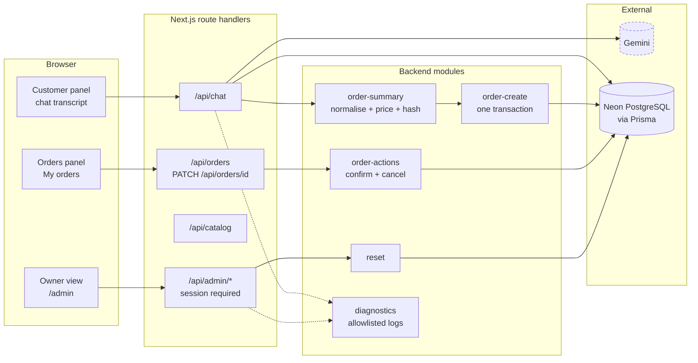

# AI Employee — Boutique Elegance

An AI shop assistant that takes clothing orders in a chat, in Arabic, Darija, French or English.

**Live demo:** <https://ai-employee-lovat.vercel.app>

---

## Try it in 60 seconds

1. Open the live demo URL above. **No passcode, no signup, no login.**
2. Write in the language you prefer — Arabic, Darija (Latin letters), French or English — and ask for a product, a size or a price.
3. Give your name, phone, delivery method and wilaya. The assistant asks for anything missing.
4. When the summary looks right, confirm it. The order is created.
5. It appears immediately in the **Orders** panel on the same page, and in **My orders**.

**Each browser sees only its own orders.** Orders are scoped to an anonymous
cookie, so a visitor can never see another visitor's name or phone number.

> Demo only. Don't enter real personal data.

---

## What is implemented

- Public chat in four languages, with the reply language following the customer.
- Real catalog read from the database, with prices and stock.
- The assistant collects the order across as many turns as needed.
- The **backend** validates every field, resolves the wilaya (69 Algerian
  wilayas), computes the item total, the delivery fee and the grand total.
- A backend-generated order summary shown before anything is created.
- A confirmation hash bound to the exact draft, so an edit invalidates it.
- One transactional order creation: stock is decremented only if it is
  available, and the order is written only if the confirmation is still valid.
- Per-visitor order list with **Confirm** and **Cancel**. Cancelling restores
  the stock exactly once. A cancelled order never becomes active again.
- A hidden owner view with a passcode, listing every order.
- Owner reset of the demo data.
- Per-conversation, per-minute and per-hour limits, and friendly handling of
  model timeouts, malformed output and provider rate limits.

## What is NOT implemented

Stated plainly, so nothing here is a surprise:

- **No real Instagram or WhatsApp integration.** The chat panel *simulates* an
  Instagram direct message thread. Nothing is sent to or from Instagram.
- **One demo shop**, one catalog, seeded by hand.
- **One product per order.**
- **No payments.** No card, no cash on delivery, no online checkout.
- **No order editing** after it is created. Cancel it and place a new one.
- **The owner session token is stateless.** It carries a signed expiry and has
  no revocation list, so a token copied before logout stays valid until it
  expires (12 hours).
- **No customer accounts, no history, no emails or SMS.**

---

## How it works

The principle is **"the AI proposes, the backend decides."**

The model is good at understanding a messy human message and at writing a
friendly reply. It is not trusted with anything that matters. So the model only
ever proposes an *action* and some *draft fields*; the backend then decides
what is true and, for every outcome that matters, sends the reply itself.

Concretely, for each turn:

1. The customer's message and a bounded context (catalog, fees, draft,
   recent turns) go to Gemini with a JSON schema.
2. Gemini returns a proposed action and draft fields. It never returns a price,
   a fee, a total, a wilaya code or a final reply for a critical outcome.
3. The backend normalises the draft, resolves the wilaya, and computes the item
   total, the delivery fee and the grand total from the database.
4. The backend builds the summary text itself, in the customer's language, and
   hashes the normalised draft together with the prices.
5. On "yes, confirm", the backend recomputes the hash inside one transaction,
   consumes the confirmation gate with a single conditional update, re-checks
   the product row, decrements stock conditionally, and inserts the order. Any
   failure rolls the whole thing back, so no partial order can exist.
6. Out-of-stock, a changed price, a confirmation that no longer matches the
   draft, a rate limit or a model failure all produce a **backend template** in
   Arabic, French or English, never a model sentence.

The result: the assistant can be wrong about words, but it cannot be wrong about
money, about stock, or about what was actually recorded.

---

## Architecture



**Read it as:** the browser never talks to Gemini or the database. Every request
goes through a route handler, which calls a backend module, which talks to the
database. Gemini (dashed) is reachable only from the chat handler. Backend
templates replace the model's reply for every critical outcome, which is why
`order-summary`, `order-create` and `order-actions` exist as separate modules
and why the model cannot reach them.

---

## Tech stack

| Part | Version | Why |
| --- | --- | --- |
| [Next.js](https://nextjs.org) | 16.4.0 (App Router, Turbopack, `cacheComponents`) | server components and route handlers in one framework |
| React | 19.3.0 | |
| TypeScript | 5.9.3 | |
| Tailwind CSS | 4.3.3 | styling only |
| [Prisma](https://www.prisma.io) | 7.10.0 | schema, migrations and the typed client |
| `@prisma/adapter-neon` | 7.10.0 | connects Prisma 7 to Neon over HTTP |
| [Neon](https://neon.tech) PostgreSQL | serverless | hosted Postgres, pooled URL at runtime, direct URL for migrations |
| [`@google/genai`](https://ai.google.dev) | 2.28.0 | the model call, with a JSON response schema |
| [zod](https://zod.dev) | 4.6.7 | request body validation |
| `dotenv` | 18.0.7 | local `.env` loading for scripts and the CLI |
| [Vercel](https://vercel.com) | Hobby, region `fra1` | hosting, matching the Neon region |
| Node.js | 24.20.0 | |

No other runtime dependency. No UI library, no icon font, no analytics.

---

## Project structure

```
app/
  page.tsx                    the whole demo: header, steps, catalog, two panels
  admin/                      hidden owner view (passcode) + ResetDemoData
  dashboard/                  MyOrders component + a redirect to /
  api/
    chat/route.ts             POST: the conversation
    catalog/route.ts          GET: public product list
    orders/route.ts           GET: this visitor's orders
    orders/[id]/route.ts      PATCH: confirm or cancel one order
    admin/login|logout|session/route.ts
    admin/orders/route.ts     GET: every order (owner)
    admin/orders/[id]/route.ts PATCH: act on any order (owner)
    admin/reset/route.ts      POST: reset the demo (owner)
  components/                 chat, demo-shell, catalog-strip, icons
  globals.css                 the palette and the two font stacks
lib/
  seed-data.ts                the ONE place the business, catalog and stock live
  gemini.ts                   the model client + failure classification
  order-summary.ts            normalisation, trusted pricing, summary, hash
  order-create.ts             the only place that creates an order
  order-actions.ts            confirm and cancel
  confirmation-gate.ts        pure gate evaluation
  order-actions.ts / reset.ts the owner reset
  visitor.ts                  the anonymous per-browser cookie
  auth.ts                     owner passcode and signed session cookie
  diagnostics.ts              one logger with a field allowlist
  wilayas.ts                  the 69 Algerian wilayas
  language.ts, draft.ts, templates.ts, delivery.ts, prisma.ts
prisma/
  schema.prisma               Business, Product, Conversation, Message, Order
  migrations/                 applied migrations, never edited after applying
  seed.ts                     creates the shop and the catalog
scripts/                      owner and test scripts (see Testing)
docs/                         specification, addendum, project status, test results
```

---

## Local setup

**Requirements**

- Node.js 20 or newer (developed and tested on 24.20.0)
- npm
- A PostgreSQL database you can reach. [Neon](https://neon.tech) has a free tier.
- A Google Gemini API key.

**Steps**

```bash
git clone https://github.com/BACHIR2007/Ai-employee.git
cd Ai-employee
npm install

# Then create .env from the template and fill in your own values.
cp .env.example .env

# Create the database tables (uses DIRECT_URL).
npx prisma migrate deploy

# Create the demo shop and its catalog (idempotent, safe to re-run).
npm run db:seed

# Start the dev server on http://localhost:3000
npm run dev
```

`npm install` runs `prisma generate` automatically, so the client is generated
for you.

The build does **not** need a live database: the page reads the catalog inside a
`<Suspense>` boundary, so `npm run build` succeeds without a reachable
`DATABASE_URL`. You do need one to actually run the app.

---

## Environment variables

Names and purposes only. **Never commit real values.** `.env.example` contains
the same list with obvious placeholders.

| Variable | Purpose | Default |
| --- | --- | --- |
| `DATABASE_URL` | Neon **pooled** connection URL, used by the running app | required |
| `DIRECT_URL` | Neon **direct** connection URL, used only by migrations | required |
| `GEMINI_API_KEY` | Server-only Google Gemini key. Never sent to the browser | required |
| `GEMINI_MODEL` | Model name, read from the environment, never hardcoded | required |
| `DASHBOARD_PASSCODE` | Owner passcode for `/admin`. Minimum 12 characters | required |
| `SESSION_SECRET` | Signs the owner session cookie. Minimum 32 characters | required |
| `DEMO_AI_CALLS_PER_HOUR` | Global cap on model calls per hour | `120` |
| `DEMO_AI_CALLS_PER_MINUTE` | Global cap on model calls per rolling minute | `12` |
| `DEMO_MAX_CUSTOMER_MESSAGES_PER_CONVERSATION` | Messages allowed in one conversation | `40` |

If `DASHBOARD_PASSCODE` or `SESSION_SECRET` is missing or too short, the owner
area **fails closed**: nobody can get in. That is deliberate.

**About the model quota.** Gemini's free tier has its own daily and per-minute
limits, and they are shared across everyone using this key. If the demo is busy
or the provider is throttling, the assistant replies with a short localized
"the shop is busy, please try again shortly" message instead of failing. That is
normal behaviour, not a bug.

---

## The hidden owner view

`/admin` is not linked from anywhere and carries `noindex`. It needs the
passcode, which is **not in this repository**. Every login attempt is logged
server-side with one of five outcomes — `success`, `mismatch`,
`not_configured`, `bad_origin`, `bad_body` — and never with the passcode, a
cookie, a token or any configured value. See the line in Vercel → Logs →
Runtime Logs, filtered on `event=admin_login`.

It shows every order across every visitor, with Confirm and Cancel, and a
**Reset demo data** section.

## Resetting the demo

Two ways. Both call the same function, `resetDemoData()` in `lib/reset.ts`.

**From the web UI:** `/admin` → unlock → scroll to **Reset demo data** → type
`RESET` → the button enables → click it. It deletes every conversation, message
and order for every visitor and restores the seeded stock. The shop and its
catalog are never deleted.

**From the command line:**

```bash
npm run reset-demo                      # dry run: prints the counts, changes nothing
npm run reset-demo -- --confirm-reset   # actually reset
```

Without `--confirm-reset` the script only prints row counts and stock, so it
cannot delete anything by accident. It prints counts only, never connection
details.

A third, narrower helper exists for tests: `npm run test:restore-stock` puts
the product stock back to the seeded values but **leaves every order alone**.

---

## Testing

```bash
npm run test:unit        # 237 offline checks, no database
npm run test:orders      # 79 checks against a real database
npm run test:restore-stock   # restores product stock only, never deletes
npm run test:scenarios -- <url>   # full chat suite against a running app
npm run reset-demo       # dry run unless --confirm-reset is passed
```

| Script | Covers |
| --- | --- |
| `test:unit` | draft validation, wilaya resolution (69 wilayas), fees, the canonical summary, the confirmation hash, the gate, language rules, delivery, price formatting and the log allowlist. No database, no model calls. |
| `test:orders` | real order creation and cancellation against PostgreSQL: the confirmation gate, the price-changed path, concurrency, out-of-stock at commit time and rollback. |
| `test:scenarios` | drives `/api/chat` end to end and checks the conversation, the summaries, the languages and the order creation. Uses real model calls. |

`docs/TEST-RESULTS.md` holds the measured results.

> **Order matters.** `npm run test:orders` and `npm run test:scenarios` **write
> real orders and conversations** to the database. Always run a reset *after*
> them and *before* handing the demo to anyone:
>
> ```bash
> npm run test:orders
> npm run reset-demo -- --confirm-reset   # clear what the tests created
> ```
>
> `npm run test:unit` writes nothing and can be run at any time.

There is also a one-off migration in `scripts/gemini-failure-test.ts` that is
kept in the history but is no longer part of the project; it is not needed.

---

## Known limitations

- The demo is a **simulator**. There is no Instagram or WhatsApp connection, and
  none is planned in this MVP.
- **One product per order.** The data model could hold more; the flow does not.
- **No payments.** The order is a record, not a transaction.
- **No order editing.** Cancel and re-order.
- **The owner session is stateless** (a signed expiry, no revocation list), so a
  token captured before logout stays valid for up to 12 hours.
- **The product catalog is fixed** and seeded by hand; there is no admin UI to
  add or edit products.
- **A short English-looking sentence inside a Darija conversation** is genuinely
  ambiguous, and the model decides which language to answer in.
- **The catalog strip reads the database on every request** and is deliberately
  never cached, so a large catalog would eventually be slow.
- **`npm audit` reports 4 high-severity advisories**, all inside the `prisma`
  CLI chain (`mysql2` and `deepmerge-ts`). This project uses PostgreSQL through
  `@prisma/adapter-neon`, the MySQL driver is never loaded at runtime, and the
  fixes available upstream require a Prisma release this project deliberately
  does not take. See `docs/PROJECT-STATUS.md`.
- **The demo key is shared**, so the whole demo shares one model quota.

---

## What happens next

The MVP proves the core loop: a customer orders in her own language, the
backend validates and prices the order, the shop owner sees it and confirms it
by phone. What is missing to make it a real product is the integration itself —
connecting the chat to the shop's actual Instagram account through the Meta
API, so the assistant answers in the real DMs instead of a simulation. After
that: more than one product per order, a small catalog editor for the shop, a
real payment or cash-on-delivery confirmation flow, and order tracking for the
customer. The limits and the reset already in place make it safe to run this in
front of real people.

---

*No licence file: the repository has none, so none is claimed here.*
